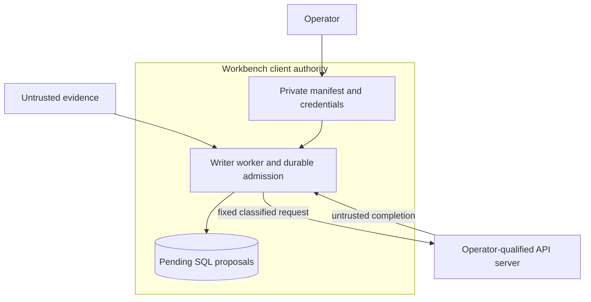

# ADR-0052: Add an explicit operator-controlled local chat API profile

Status: ACCEPTED. Date: 2026-10-19.

## Context and decision criteria

Native generation requires an identity-checked llama.cpp Unix socket and local
GGUF file. Embeddings and reranking use local ONNX subprocesses. These paths do
not integrate an operator's existing OpenAI-compatible local inference service.
The cloud route deliberately denies private destinations and adds sovereignty,
release and monetary accounting. Relabelling a private service as cloud or
loosening the cloud destination guard would confuse these authority boundaries.

Criteria are explicit destination/data authority, interoperable structured
extraction, reusable managed secrets, bounded work, honest model identity and
unknown-outcome handling. Locality is not sovereignty proof: Ollama explicitly
supports forwarding cloud models through its local server. Operator deployment
qualification and disabled forwarding are required, not inferred from an IP.

## Alternatives

| Option | Consequences |
| --- | --- |
| No change; native socket only | Strong local identity checks but leaves existing API stacks unsupported |
| Relax cloud transport and use zero-cost routes | Undermines public-only routing and financial policy; rejected |
| Vendor SDKs, discovery and automatic fallback | Adds dependencies and hidden endpoint/capability selection; deferred |
| Explicit bounded compatible chat API | Reuses HTTP core and proposal validation, keeps deployment trust visible; selected |

## Decision and compatibility

Add `enrich --local-api-manifest` as the third explicit generator selection,
alongside native `--manifest` and governed `--route`. Exactly one is selected.
Enrichment enqueue additionally reports atomic stored job state and an explicit
`terminal_preserved` disposition instead of suggesting a terminal dedup hit was
requeued. Existing string-returning Python callers and job identities remain.
No default endpoint, discovery, proxy environment, redirect, download, streaming,
tool execution, arbitrary route or fallback is added. MCP stays seven reads.
The selected API is `/v1/chat/completions`; `/v1/models` confirms the configured
alias before dispatch. Both responses share an absolute deadline and byte bound.
HTTP permits literal loopback addresses only; other permitted destinations are
literal RFC1918 or IPv6 ULA addresses over verified TLS with a managed credential.
DNS names, public/link-local/unspecified/mapped addresses are refused. Optional
custom trust is hash-bound, regular-file admitted and loaded into a private TLS
context. OS trust is otherwise used; certificate checks cannot be disabled.

The private manifest binds endpoint, model alias, operator-declared model revision,
qualification evidence digest, permitted data classes and budgets. It requires
operator control, no remote forwarding and no metered backend. These are explicit
operator assertions, not remotely verified weight, billing or jurisdiction facts.
The identity includes destination and trust hashes; credential-value rotation
preserves identity. File/systemd credential resolution reuses existing custody
checks. No environment-value credential fallback is introduced. Exact active
credential reflection is refused after decoded typed-output validation.

Requests contain separate system/user messages and a JSON Schema response format,
with bounded output and no tools. Chat templates are controlled by the service;
this profile does not reproduce native literal-token isolation or exact tokenizer
context preflight. Input byte bounds are not a context-fit or semantic-quality
proof. Qualify server templates, context, resource limits, aliases and structured
output support separately. API responses are independently schema checked and
retain the same quotation, pending-review, lifecycle and fenced SQL acceptance.

The implemented trust boundaries are:

| Relevant STRIDE concern | Control and residual boundary |
| --- | --- |
| Spoofing or destination substitution | Literal configured IP, fixed routes and verified TLS outside loopback HTTP; loopback still trusts host/network namespace custody |
| Tampering, disclosure or privilege escalation | Independent typed/quote validation, managed bearer reference, no redirects/tools/fallback and exact active-secret reflection refusal; server templates and forwarding remain operator responsibilities |
| Denial of service or duplicate execution | Absolute deadline, byte limits, bounded output request and durable uncertainty admission; no physical termination, server resource quota or cross-host scheduler is claimed |

## Uncertainty and recovery

Extend the shared host-local marker reader with the distinct
`local-api-operation/1` receipt: operation UUID, generator identity and request
hash. Preserve native receipt bytes/fields. Persist and fsync it before the POST.
A recognized complete terminal response releases admission before typed-result
validation. Ambiguous responses, HTTP errors after submission, timeouts and
crashes retain it. All cooperating native/API/ONNX work stays blocked. A failed
job is terminal for this code, and job cancellation does not prove termination.

A generic health/model probe cannot establish prior request termination. Explicit
reconciliation requires the exact operation UUID, operator confirmation and a
private evidence digest. Write/fsync an exclusive private resolution record before
removing the exact marker. Audit names use a bounded validated operation UUID,
independent of the configured lock basename. A crash after audit write can be retried idempotently;
conflicting, partial or unsafe records remain blocked. This is an operator
termination attestation, not an API cancellation or independent termination proof.
Native reconciliation cannot clear API receipts and vice versa. The original
same-account/cooperating-client custody limitations remain.

## Threats, evidence and remaining work

Under existing STPA SC1/SC2/SC3/SC4/SC7 and the inference custody constraints,
wrong destinations, secret leakage, silent disclosure escalation and replay of
uncertain work are the consequential failure paths. Literal destinations, TLS,
managed secrets, data classification, fixed routes, schema/quote validation and
durable receipts address those paths within the declared operator boundary.
A malicious/reconfigured same-UID service or forwarding gateway remains outside
that boundary; a schema-valid proposal can still be false or unsupported.

`tests/test_local_api.py` exercises real HTTP/TLS and filesystem outcomes;
`tests/test_local_api_integration.py` covers the actual native chat wire path,
SQL proposal/abstention/evidence refusal and terminal unknown jobs. Existing
native marker, cancellation, credential and MCP tests preserve their contracts.
These establish synthetic execution contracts, not actual Ollama/vLLM adoption,
useful models, GPU/resource qualification or independent human review.

## Blast radius and rollback

Changes affect explicit CLI selection, the new adapter, shared receipt parsing
and documentation. Core schema 11, retrieval profile 4, checkpoint format 2,
dependencies, cloud policy/ledger and existing model identities remain unchanged.
No operational service is started or reconfigured. The workbench remains a client.

Disable the selected API profile to stop new API work. Before downgrading clients,
stop cooperating workers, establish termination and resolve any API receipt using
the current evidence-bound procedure. Preserve resolution records privately.
An older binary refuses the new receipt; never delete it or change lock paths to
make old code run. Retain schema/data pairs for unrelated migrations.

Primary interfaces checked 2026-10-19:
[Ollama compatibility](https://docs.ollama.com/api/openai-compatibility),
[Ollama structured outputs](https://docs.ollama.com/capabilities/structured-outputs),
[vLLM structured outputs](https://docs.vllm.ai/en/stable/features/structured_outputs/).
