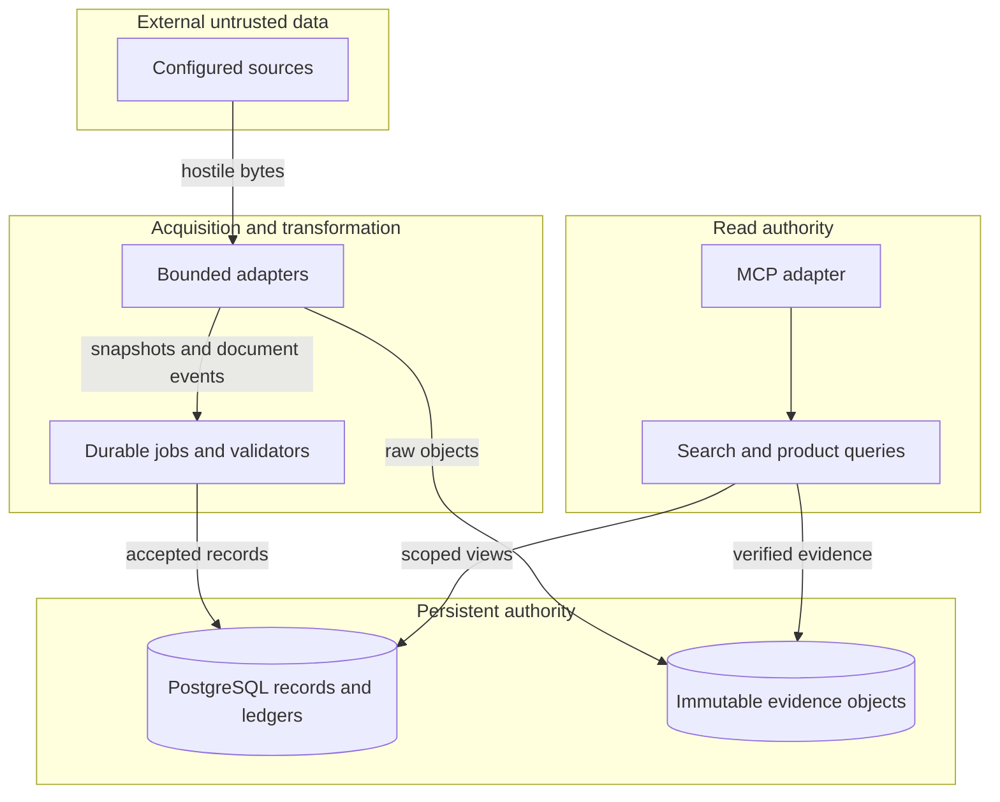
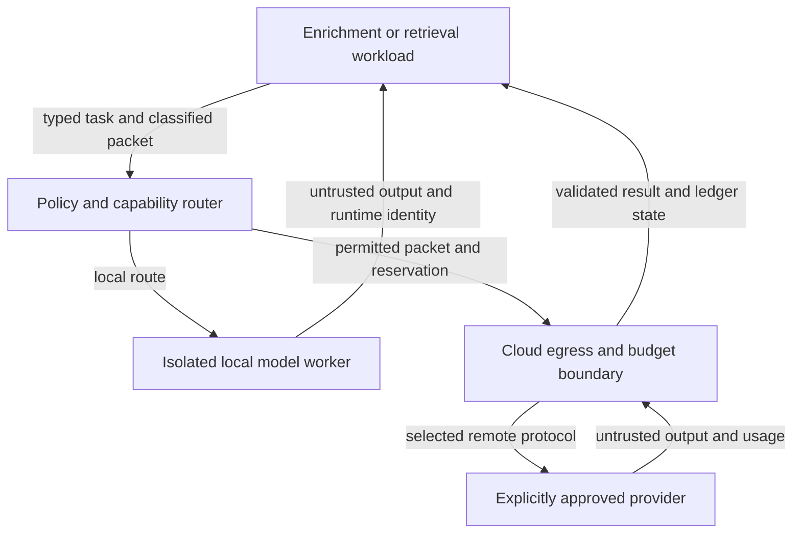

> Target specification. See STATUS.md for implemented and verified scope.

# Complete target architecture

This is the target responsibility and trust-boundary model, not a deployment
inventory. [STATUS](../STATUS.md) is authoritative for bounded implemented scope;
[the backlog](implementation-backlog.md) records the remaining work. Proposed
schemas, states, module directories and tool groups below must not be read as
existing interfaces.

## Implemented boundary

The current package uses a modular, mostly flat Python layout, PostgreSQL and a
content-addressed evidence root. Its SQL groups separate collector, writer,
reader, reviewer, lifecycle, purger and accounting authority from the schema owner. The
writer still combines normal ingest, enrichment, retrieval and selected cloud
work; a separate credential-holding dispatcher and per-workspace authorization
are not implemented. Local search can execute its configured encoder/reranker;
the seven MCP tools do not expose arbitrary model selectors or generation jobs.
The remote enrichment route is implemented; remote MCP transport is not. An
explicit [local chat API profile](local-inference-api.md) connects operator-qualified
private-address services. Its server/model/forwarding assertions are weaker than
the native Unix-socket identity checks and are not cloud-policy exceptions.

The non-root feed/API collector, bounded chunk-worker and aggregate-health
systemd templates and disposable service harness already exist. API acquisition
includes bounded credential references, client-credentials OAuth and a KEV-format
adapter; it does not establish restricted-content isolation or actual provider
qualification. A complete Compose deployment and the other process separations
below remain targets. The [deployment guide](deployment.md) distinguishes current
fixtures from operational acceptance.

## Structure and authority

Use one modular Python application with shared contracts, a CLI and a read-only MCP adapter. Use PostgreSQL as the record/job/graph/accounting authority and a content-addressed evidence volume. pgvector is an optional retrieval-profile extension. Local model processes and remote provider workers are separate resource/egress boundaries because they load untrusted artifacts or hold credentials, not because every feature needs a separate service.

Split process identities: schema migrator; source collector; normalized-document writer; enrichment/graph writer; embedding/index writer; model runtime; cloud dispatcher; report renderer; optional external publisher; application/MCP reader. Combine low-risk roles only when authority is equivalent and tests establish the intended grants. No application identity is a superuser/schema owner. MCP cannot trigger arbitrary source acquisition, select arbitrary models, enqueue generation, write context or launch host operations. Configured local query embedding/reranking remains part of read execution. Operator workflows use typed CLI/job APIs.





The operator-selected MCP client is another disclosure boundary: the application may be local while the client/model is external. Returned content and excerpts are intentional disclosures, not anonymized data. Default location metadata omits private URLs/paths, but that does not remove personal data from arbitrary document bodies. No unattended model instruction can authorize egress or new tools.

## Data contracts and lineage

Persist source/acquisition/snapshot/document records; immutable chunks; embedding spaces/vectors and index generations; job/run/attempt/lease records; extraction proposals/accepted assertions/alias events; report bundles; domain records; workspace context; model/provider/prompt/schema manifests; route decisions; reservations and usage/cost/batch operations; publication receipts and audit events.

Every derived record identifies input snapshot/chunk hashes, producing code/config/prompt/schema/model revision, run/attempt, time, status and reason. Graph evidence spans name the coordinate space and normalized-text hash. Use original-text code-point offsets with a reversible mapping when normalization changes length; never apply casefolded offsets directly to original text. Hashes prove bytes, not truth. Model agreement or repeated calls to the same source do not establish independent corroboration.

Independent states: acquisition success/failed/blocked; extraction usable/partial/failed; integrity verified/mismatch/missing; freshness fresh/stale/unknown/disabled; derivation proposed/accepted/rejected/quarantined/superseded; review unreviewed/reviewed with actor/time/rationale. Authoritative structured facts remain assertions attributed to a source, not universal truth labels. Numerical confidence requires a separately calibrated meaning; otherwise use descriptive dispositions.

## Persistence, jobs and consistency

Use direct parameterized PostgreSQL access and minimal versioned migrations, removing SQL-dialect translation. Start with one job table supporting scheduled/ready/leased/running/succeeded/failed/cancel-requested/cancelled/outcome-unknown, attempt count, next-attempt time, lease owner/expiry and fencing token. Transactionally enqueue downstream jobs through an outbox; consumers are idempotent. PostgreSQL SKIP LOCKED is a candidate implementation to validate under contention, not a claim of exactly-once execution.

Promote flushed evidence objects atomically on the same filesystem, then commit accepted metadata plus outbox. A failed transaction can leave a detectable orphan, never a falsely accepted missing object. Reconciliation, retry and GC use reachability and run identities. Search activation switches a complete generation atomically; incomplete backfills cannot replace the last usable generation. Failed jobs expose non-execution/partial progress; retries do not silently mutate or republish immutable reports.

Separate domain facts, model-derived assertions and private operator context in schemas/roles with explicit joins/disclosure policy. Partition or isolate incompatible embedding spaces and apply workspace/source authorization before fusion, reranking and graph expansion. Cross-workspace caches or approximate indexes must not introduce disclosure or untested recall effects. No multi-tenant deployment is claimed; isolated single-operator workspaces still need permission-negative tests.

## Deployment and profiles

Provide a Linux Compose reference with core, retrieval, local-inference, enrichment, domain, cloud and publishing profiles. Core can run without ML/cloud, but full release acceptance includes all profile contracts. Provide a CPU local smoke profile and a separately tested acceleration profile; do not publish private hardware inventory or claim all GPUs supported. The existing bounded native/systemd collector reference is documented separately; extending it requires profile-specific tests, not copied operational units. Run database, evidence, model caches and secrets outside the source tree.

Maintain core, ML and provider dependency groups/locks; heavy libraries and custom model code never load in MCP. Model acquisition is an explicit operator step with hashes/licenses and no runtime internet; model weights are not bundled. Generic OCI-compatible packaging permits local builds and mirroring. GitHub is a chosen distribution channel, not a runtime dependency or a sovereignty guarantee.

## MCP and operator contracts

MCP read tool groups: document/search/evidence/source/status; graph/assertion/briefing/report/context reads; vulnerability/advisory queries; regulatory instrument/procedure/evidence reads; aggregate model/profile/job/usage health with private fields redacted. Register only tools for enabled capabilities; publish a versioned tool manifest and stable JSON schemas. The current seven-tool stdio interface is a bounded implemented subset, not the final target interface cap.

No arbitrary SQL, paths, URLs, shell, raw logs, provider keys or host-control tools. Default transport stdio. An optional remote MCP profile implements authenticated Streamable HTTP with TLS, maintained OAuth/resource-server components, issuer/audience/expiry/scope validation, principal/workspace authorization, bounded sessions and no token passthrough. It is disabled by default and must pass E49-E51 before activation. Scope mutations to operator CLI/job commands with operation IDs, validation, idempotency and reconciliation. MCP job-control tools are not required by the current use case and cannot appear implicitly.

## Limits and configuration

All budgets are typed: source wall/byte/parser limits, task/context/output tokens, pending/concurrent jobs, query/candidate/rerank counts, GPU/CPU memory admission, request/stream/batch deadlines, retries and monetary/token quotas. Original proposed numeric defaults are trial settings, not measured capacity. Freeze validated profile defaults and tests before acceptance. Unknown quota/config/capability state denies execution requiring that authority while preserving read-only evidence access.

Each profile specifies supported versions, capability probes, data classes, errors, enabled/disabled/degraded states and recovery. Empty source/provider configuration makes no external requests. Endpoint/model/source labels come from user-supplied configuration; code contains no operational feed catalogue or private deployment identities.

## Repository structure

```text
src/osint_workbench/
  contracts/, configuration/, cli/, application/
  acquisition/, extraction/, evidence/, repositories/, jobs/
  chunking/, embeddings/, retrieval/, reranking/
  inference/, routing/, providers/, accounting/
  enrichment/, graph/, briefings/, context/
  domains/vulnerability/, domains/regulatory/, adapters/
  products/, publishing/, lifecycle/, observability/, mcp/
migrations/core/, migrations/retrieval/, migrations/domains/
deploy/profiles/, config/*.example.*, tests/{unit,integration,e2e,quality}/
docs/{adr,profiles,assurance,security,operations,testing,release}/
```

This is a responsibility map; do not create empty modules to simulate completeness. Consolidate files where responsibilities and authority are truly the same. Maintain one application search path and one model/provider contract instead of multiple translated implementations.
